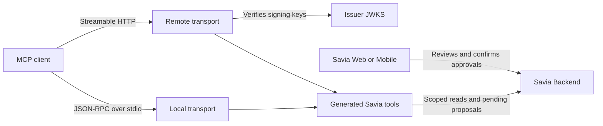

<!-- markdownlint-disable-next-line MD041 -->
<div align="center">

<h1>Savia MCP</h1>

<p><strong>Let an MCP client read your Savia workspace and propose changes for approval.</strong></p>

<p>
<a href="https://github.com/diegnghtmr/savia-mcp/actions/workflows/ci.yml"></a>


<a href="LICENSE"></a>
</p>

<p>
<a href="https://diegnghtmr.me/en/work/savia/"><strong>Case study</strong></a> &bull;
<a href="#quick-start"><strong>Quick start</strong></a> &bull;
<a href="#architecture"><strong>Architecture</strong></a> &bull;
<a href="https://github.com/diegnghtmr/savia-backend"><strong>Backend API</strong></a> &bull;
<a href="https://github.com/diegnghtmr/savia-web"><strong>Web app</strong></a> &bull;
<a href="https://github.com/diegnghtmr/savia-mobile"><strong>Mobile app</strong></a>
</p>

</div>

Savia MCP gives assistants access to selected workspace data without letting them apply financial changes directly. It generates both transports' tool schemas from one pinned OpenAPI contract. When a tool proposes a change, the user reviews it in Savia Web or Mobile.

## Features

- **Scoped reads.** The 14 read tools include `get_debt_projection` and `get_sinking_fund` under `budgets:read`; three annotated read operations use POST.
- **Approval-gated changes.** The other 14 tools submit only `POST /v1/mcp/proposals` and return the pending approval ID, preview, expiry, and status.
- **Two transports.** Start an MCP child process over stdio or serve stateless Streamable HTTP with JSON POST responses.
- **Contract-based validation.** Schemas reject undeclared keys, including an own `__proto__` key, and count Unicode string lengths as OpenAPI does.
- **Bounded upstream calls.** Requests do not follow redirects and have a two-second deadline and a 1 MiB response limit.

## Quick start

Install Node.js **24.18.0** and pnpm **11.15.1**. You need a reachable Savia API and a credential with the scopes for the tools you intend to call.

```sh
git clone https://github.com/diegnghtmr/savia-mcp.git
cd savia-mcp
pnpm install --frozen-lockfile
pnpm build
```

### Local stdio

Configure your MCP client to launch `node dist/server.js` from the repository. Pass configuration through the child process environment, not through tool arguments:

| Variable | Purpose | Default |
| --- | --- | --- |
| `SAVIA_API_URL` | Savia API base URL; HTTPS except on loopback. | None |
| `SAVIA_MCP_TOKEN` | Bearer token; proposals require a grant-bound OAuth credential accepted by the API. The local process does not obtain it. | None |
| `SAVIA_WORKSPACE_ID` | Default workspace UUID; an explicit tool argument takes precedence. | None |

The process exits `0` on EOF, `130` on SIGINT, and `143` on SIGTERM.

### Remote Streamable HTTP

Set the remote environment and run `node dist/remote.js`. The listener binds to `127.0.0.1`.

| Variable | Purpose | Default |
| --- | --- | --- |
| `SAVIA_MCP_PROPOSAL_AUDIENCE` | Exact canonical MCP URL, used as OAuth resource and sole token audience. | None |
| `JWT_ISSUER` | Trusted issuer URL (for Supabase Auth, include `/auth/v1`); its JWKS is cached for up to 60 seconds. | None |
| `SAVIA_API_URL` | Bare origin serving the resource's Savia `/v1` routes; same origin as the audience, with no base path. HTTPS except for loopback fakes. | None |
| `SAVIA_WORKSPACE_ID` | Optional default workspace UUID. | None |
| `SAVIA_MCP_PORT` | Local listener port. | `3000` |

Outside loopback, use a TLS proxy that preserves `Host` and routes the MCP path and its path-specific `/.well-known/oauth-protected-resource` endpoint here. Route the API on the same public origin and OAuth resource. Requests without an acceptable bearer receive a `401` challenge pointing to that metadata. There is no standalone SSE stream, session deletion, or static-token fallback. Remote tokens must be ES256 or RS256 with the expected issuer and sole audience, a valid expiry, and signed UUID `sub` and `mcp_grant_id` claims. Savia checks the live grant, including ownership, revocation, tool access, and scopes. The token is forwarded only to Savia and never logged; upstream `401` and `403` tool errors reveal only the status.

### Tool inputs and retries

Path and query parameters are top-level arguments; JSON payloads go under `body`. Schemas mark required OpenAPI headers, including `ifMatch` for `update_sinking_fund`. For updates that require it, provide the resource's quoted ETag; budget and transaction mutation proposals require it even when their direct API operations do not. Stdio can supply the workspace from `SAVIA_WORKSPACE_ID` and generate a UUID when `idempotencyKey` is omitted. Pass and reuse your own UUID for a retry: a second call without a key gets a new one. In `update_transaction`, `body.extraordinary` can set or clear the manual classification; omit it to leave the classification unchanged.

`scan_receipt` is deliberately absent from both catalogs: the multipart upload cannot be represented in a JSON proposal or rolled back with approval execution. It would require a staged upload reference and a storage lifecycle in the backend contract.

## Architecture

Both transports use the catalog generated from Savia OpenAPI authority `9785033`. The backend owns authorization and proposal state, and the web or mobile client owns review and confirmation.



## Tech stack

| Layer | Technology |
| --- | --- |
| Runtime | Node.js 24.18.0, TypeScript 5.9.3 |
| Protocol | `@modelcontextprotocol/sdk` 1.29.0 |
| Validation and generation | Zod 4.4.3, OpenAPI, js-yaml |

## Testing

```sh
pnpm audit:static
pnpm build
pnpm test
```

CI runs the static audit, build, and tool, remote, and protocol tests. The tests use loopback issuer/JWKS and API fakes; they do not verify compatibility with a live Supabase OAuth project.

To regenerate in the development workspace with the external authority checkout available:

```sh
pnpm tools:generate --authority ../../odd/authority/savia-openapi-9785033.yaml
```

Add `--check` to verify without writing. `SAVIA_OPENAPI_AUTHORITY` selects the same YAML-only mode. Otherwise the generator uses `../../docs/savia-openapi.json` and compares complete `x-savia-mcp-tool` annotations with the YAML when present; formatting isn't drift. Override inputs with `--openapi`, `--yaml`, and `--prd`, or with `SAVIA_OPENAPI_PATH`, `SAVIA_OPENAPI_YAML_PATH`, and `SAVIA_PRD_PATH`. An explicit missing OpenAPI path errors without changing the manifest. With no overrides, `--check` skips if both default OpenAPI inputs are absent; if only YAML is absent, it checks against JSON.

## Related repositories

- [savia-backend](https://github.com/diegnghtmr/savia-backend) — API and approval ownership.
- [savia-web](https://github.com/diegnghtmr/savia-web) — browser workspace and account setup.
- [savia-mobile](https://github.com/diegnghtmr/savia-mobile) — Expo client for Android and iOS.
- [savia-cli](https://github.com/diegnghtmr/savia-cli) — command-line client.

## License

[MIT](LICENSE).
